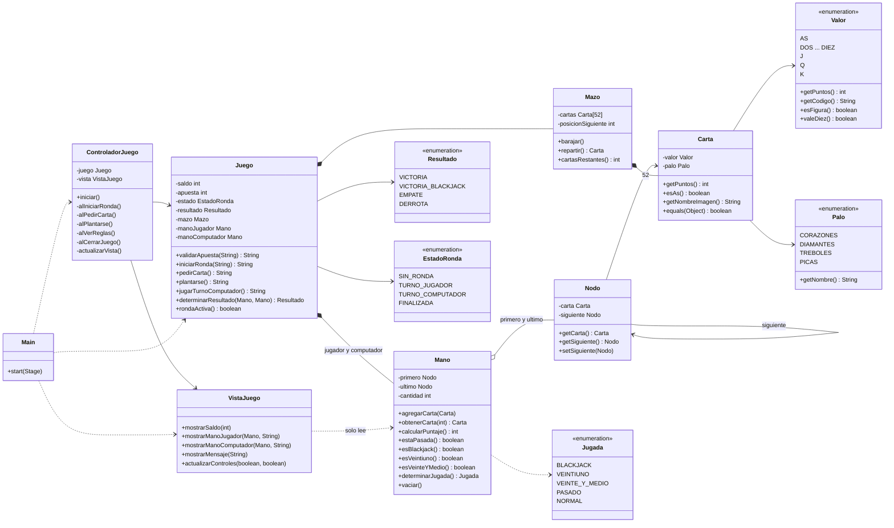

# Diagrama de clases (UML)

## Paquetes (MVC)

| Capa | Clases |
|---|---|
| Modelo | Palo, Valor, Carta, Nodo, Mano, Mazo, Jugada, Resultado, EstadoRonda, Juego |
| Vista | VistaJuego |
| Controlador | ControladorJuego |